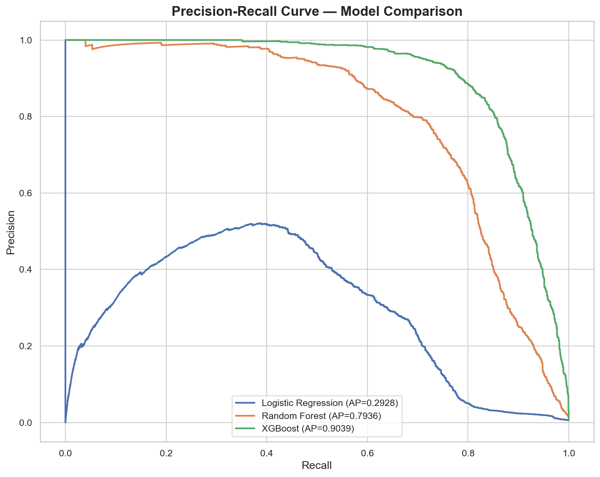

# Credit Card Fraud Analytics: SQL + Python


End-to-end fraud analytics on **1.3 million credit card transactions**:
PostgreSQL for exploration, business analysis and rule-based detection
(CTEs, window functions, views, indexes), Python for statistical testing and
machine learning, and an interactive Streamlit dashboard.

---

## Business Problem

Card issuers need to find fraud quickly without blocking good customers. This
project answers four questions with SQL and statistics:

- Which categories, hours and states carry the most fraud risk?
- How different are fraudulent transactions from legitimate ones?
- How far can simple SQL rules go in flagging fraud?
- How much better does a machine-learning model do, evaluated honestly on future transactions?

The analysis is offline (batch) on historical data.

---

## Dataset

| Property | Value |
|---|---|
| Source | [Kaggle: Credit Card Transactions Dataset](https://www.kaggle.com/datasets/priyamchoksi/credit-card-transactions-dataset) |
| Type | **Simulated** transactions (generated with the Sparkov data generator) |
| Rows | 1,296,675 transactions |
| Period | January 2019 to June 2020 |
| Fraud rate | 0.58% (7,506 fraud / 1,289,169 legitimate) |
| Columns | 24 |

The CSV is not stored in this repo. Download it from Kaggle into `data/`.

---

## Project Structure

```
├── sql/
│   ├── 01_schema.sql           table definition, constraints, CSV load
│   ├── 02_exploration.sql      profiling, class balance, null & duplicate checks
│   ├── 03_analysis.sql         business questions (category, hour, state, monthly MoM, merchant)
│   ├── 04_fraud_detection.sql  velocity check (LAG), spend vs card history, risk-score view
│   └── 05_views_indexes.sql    indexes, reporting views, materialized card profile, EXPLAIN
├── python/
│   ├── db.py                   database connection from environment variables
│   ├── 01_visualizations.py
│   ├── 02_statistical_analysis.py
│   ├── 03_dashboard.py         Streamlit app
│   └── 04_machine_learning.py
├── insights/                   generated charts (stats/, ml/)
├── .env.example
└── requirements.txt
```

---

## Tech Stack

| Layer | Tools |
|---|---|
| Database | PostgreSQL |
| SQL | CTEs, window functions (LAG, running averages), FILTER, views, materialized views, partial indexes |
| Language | Python 3.13 |
| Data | pandas, NumPy |
| Visualization | matplotlib, seaborn, Plotly |
| Statistics | SciPy |
| Machine learning | scikit-learn, XGBoost, imbalanced-learn |
| Dashboard | Streamlit |

---

## SQL Analysis

All queries are in [`sql/`](sql/). Highlights:

**Fraud rate by category** (`03_analysis.sql`)
```sql
SELECT category,
       COUNT(*)                                   AS transactions,
       SUM(is_fraud)                              AS fraud_count,
       ROUND(SUM(is_fraud) * 100.0 / COUNT(*), 2) AS fraud_rate_pct
FROM transactions
GROUP BY category
ORDER BY fraud_rate_pct DESC;
-- shopping_net (1.75%) > misc_net (1.42%) > grocery_pos (1.36%)
```

**Spend vs the card's own history, without look-ahead** (`04_fraud_detection.sql`)
```sql
AVG(amt) OVER (PARTITION BY cc_num
               ORDER BY trans_date_trans_time
               ROWS BETWEEN UNBOUNDED PRECEDING AND 1 PRECEDING) AS prior_avg
```
The window ends one row *before* the current transaction, so the average uses
only what was known at the time.

**Velocity check** uses `LAG()` per card to find transactions within 10 minutes
of the previous one.

**Rule-based risk score** (view `v_risk_scores`, max 7): amount band (0-3) +
high-risk online category (2) + late-night hour 22:00-03:59 (2). Scores ≥ 5 are
High Risk, ≥ 3 Medium Risk.

<!-- RULE_RESULTS: paste the output of query 4 in sql/04_fraud_detection.sql here -->

---

## Key Findings

### Finding 1 — Fraud amounts are 7.8x higher
```
Average fraud transaction  : $531.32
Average legit transaction  : $67.67
Difference                 : 7.86x higher
Min fraud amount           : $1.06
Max fraud amount           : $1,376.04
Statistical test           : Mann-Whitney U (p < 0.0001) 
```

### Finding 2 — Night time is peak fraud time
```
Peak fraud hour  : 22:00 — 23:00 (2.88% fraud rate)
Normal daytime   : ~0.1% fraud rate
Difference       : 28x higher fraud rate at night
Chi-Square test  : p < 0.0001  — hour IS significant
```

### Finding 3 — Category strongly predicts fraud
```
Highest risk : shopping_net   (1.75% fraud rate)
Second risk  : misc_net       (1.42% fraud rate)
Third risk   : grocery_pos    (1.36% fraud rate)
Lowest risk  : health_fitness (0.13% fraud rate)
Chi-Square test : p < 0.0001 — category IS significant
```

### Finding 4 — Geographic concentration
```
Top fraud states by amount lost:
NY : $298,000
TX : $263,000
PA : $246,000
CA : $169,000
OH : $167,000
```

### Finding 5 — December 2019 spending spike
```
December 2019 spending : ~$10,000,000 (2x any other month)
Normal monthly average : ~$5,000,000
Likely driven by holiday season transactions
```

### Finding 6 — Transaction amount correlation
```
Point-Biserial Correlation : 0.2194
P-value                    : p < 0.0001 
Strength                   : Weak positive correlation
Meaning                    : Higher amounts = more likely fraud
```

---

## Statistical Tests

```
Test 1 — Descriptive Statistics
  Fraud mean    : $531.32  |  Legit mean : $67.67
  Fraud median  : $396.50  |  Legit median : $47.28
  Fraud std dev : $390.56  |  Legit std dev : $154.01

Test 2 — Mann-Whitney U Test
  Result : Fraud amounts ARE significantly different (p < 0.0001) ✅

Test 3 — Chi-Square Test (Category)
  Chi2   : 6,486.00  |  df : 13
  Result : Category IS significantly dependent on fraud (p < 0.0001) ✅

Test 4 — Point-Biserial Correlation
  Correlation : 0.2194 (Weak Positive)
  Result : Amount IS significantly correlated with fraud (p < 0.0001) ✅

Test 5 — Chi-Square Test (Hour)
  Chi2   : 18,243.56
  Result : Hour of day IS significantly associated with fraud (p < 0.0001) ✅
```

---

## Machine Learning

### Approach

- **Features (13):** amount, hour, day of week, month, weekend and night flags,
  spend ratio vs the card's *previous* average, the card's previous average,
  customer-merchant distance, number of the card's transactions in the
  *previous* 24 hours, encoded category and gender, city population.
- **No look-ahead.** Customer features use only earlier transactions.
- **Time-based split.** Train on the earliest 80% of transactions, test on the
  latest 20%, because a fraud model always scores future transactions.
- **Class imbalance:** SMOTE on the training set only (10% ratio) for Logistic
  Regression and Random Forest; `scale_pos_weight` for XGBoost.
- **Metrics:** average precision (PR-AUC) is the main metric. With 0.58% fraud,
  ROC-AUC and accuracy look high even for weak models.

### Results

<!-- ML_RESULTS: fill from insights/ml/metrics.json after running python/04_machine_learning.py -->

### Why the results changed

An earlier version reported ROC-AUC 0.9982 and 97% recall. That evaluation was
optimistic for two reasons:

1. **Look-ahead features.** The customer's average spend and daily transaction
   count were computed over the whole dataset, including the transaction being
   scored and later ones.
2. **Random split.** Shuffling put future transactions into training.

Both are fixed: features use only the past, and the test set is strictly later
than the training set.



---

## Interactive Dashboard

Built with Streamlit:

- Filters by category, gender, amount range and transaction type
- 5 KPI metrics that update with the filters
- 8 interactive Plotly charts, including monthly spend vs fraud count
- Raw data explorer with a fraud-only toggle

---

## How to Run

**1. Clone and install**
```bash
git clone https://github.com/jd878-gif/credit-card-fraud-analytics.git
cd credit-card-fraud-analytics
pip install -r requirements.txt
```

**2. Configure the database connection.** Copy `.env.example` to `.env` and set
your PostgreSQL credentials. `.env` is git-ignored.

**3. Create the table and load the data**
```bash
createdb credit_card_db
psql -d credit_card_db -f sql/01_schema.sql
psql -d credit_card_db -c "\copy transactions FROM 'data/credit_card_transactions.csv' WITH (FORMAT csv, HEADER true)"
psql -d credit_card_db -f sql/05_views_indexes.sql
```

**4. Run the SQL analysis**
```bash
psql -d credit_card_db -f sql/02_exploration.sql
psql -d credit_card_db -f sql/03_analysis.sql
psql -d credit_card_db -f sql/04_fraud_detection.sql
```

**5. Run the Python pipeline** (from the repo root)
```bash
python python/01_visualizations.py
python python/02_statistical_analysis.py
python python/04_machine_learning.py
streamlit run python/03_dashboard.py
```

---

## Future Improvements

- SHAP values to explain individual predictions
- Tune the decision threshold for a target precision and report the business cost of false positives
- Deploy the dashboard to Streamlit Community Cloud
- Serve the model behind a FastAPI endpoint

---

## Author

**Jeet Dave** · MS Data Science, NJIT (May 2027)
[GitHub](https://github.com/jd878-gif) · [LinkedIn](https://linkedin.com/in/jeetdave11)

## License

Code: MIT. Data: see the dataset's Kaggle page for its license.
