💳 Credit Card Fraud Detection System


> An end-to-end fraud detection system built on 1.3 million real credit card
> transactions — combining SQL analytics, statistical analysis, machine learning,
> and an interactive dashboard.


🎯 Business Problem

Credit card fraud costs the global economy **$32 billion annually**.
Financial institutions need systems that can:
- Detect fraudulent transactions in real time
- Minimize false positives (flagging legitimate customers)
- Identify high-risk merchants, categories and time patterns
- Explain *why* a transaction is suspicious

This project builds exactly that — from raw data to a working fraud detection model.


📊 Dataset

| Property | Value |
|---|---|
| Source | [Kaggle — Credit Card Transactions](https://www.kaggle.com/datasets/priyamchoksi/credit-card-transactions-dataset) |
| Rows | 1,296,675 transactions |
| Period | January 2019 — June 2020 |
| Fraud Rate | 0.58% (highly imbalanced) |
| Legitimate Transactions | 1,289,169 (99.42%) |
| Fraud Transactions | 7,506 (0.58%) |
| Features | 24 columns |


🏗️ Project Structure
```
credit-card-fraud-detection/
├── README.md
├── insights/
│   ├── ml/
│   │   ├── 01_roc_curve.png
│   │   ├── 02_precision_recall.png
│   │   ├── 03_confusion_matrix.png
│   │   ├── 04_feature_importance.png
│   │   └── 05_model_comparison.png
│   ├── stats/
│   │   ├── amount_by_category_boxplot.png
│   │   ├── correlation_heatmap.png
│   │   └── kde_amount_distribution.png
│   ├── 01_fraud_vs_legit.png
│   ├── 02_spending_by_category.png
│   ├── 03_fraud_rate_by_category.png
│   ├── 04_amount_distribution.png
│   ├── 05_fraud_by_hour.png
│   ├── 06_monthly_trend.png
│   ├── 07_fraud_by_gender.png
│   └── 08_fraud_by_state.png
├── python/
│   ├── 01_visualizations.py
│   ├── 02_statistical_analysis.py
│   ├── 03_dashboard.py
│   └── 04_machine_learning.py
├── sql/
│   ├── 01_schema.sql
│   ├── 02_exploration.sql
│   ├── 03_analysis.sql
│   ├── 04_fraud_detection.sql
│   └── 05_views_indexes.sql
└── SQL_Dataset/
    └── credit_card_transactions.csv
```


🔧 Tech Stack

| Layer | Tools |
|---|---|
| Database | PostgreSQL 18 |
| SQL | Window functions, CTEs, subqueries, views, indexes |
| Language | Python 3.13 |
| Data | pandas, numpy |
| Visualization | matplotlib, seaborn, plotly |
| Statistics | scipy |
| Machine Learning | scikit-learn, XGBoost, imbalanced-learn |
| Dashboard | Streamlit |


📁 SQL Analysis

### Business Questions Answered

**1. What is the overall fraud rate?**
```sql
SELECT 
    is_fraud,
    COUNT(*)                                          AS total,
    ROUND(COUNT(*) * 100.0 / SUM(COUNT(*)) OVER(), 2) AS percentage
FROM transactions
GROUP BY is_fraud;
-- Result: 99.42% legitimate | 0.58% fraud
```

**2. Which categories have the highest fraud rate?**
```sql
SELECT 
    category,
    ROUND(SUM(is_fraud) * 100.0 / COUNT(*), 2)       AS fraud_rate_pct
FROM transactions
GROUP BY category
ORDER BY fraud_rate_pct DESC;
-- Result: shopping_net (1.75%) > misc_net (1.42%) > grocery_pos (1.36%)
```

**3. Which hours are most dangerous?**
```sql
SELECT 
    EXTRACT(HOUR FROM trans_date_trans_time)          AS hour,
    ROUND(SUM(is_fraud) * 100.0 / COUNT(*), 2)       AS fraud_rate_pct
FROM transactions
GROUP BY hour
ORDER BY fraud_rate_pct DESC
LIMIT 3;
-- Result: 22:00 (2.88%), 23:00 (2.84%), 01:00 (1.55%)
```

**4. Multi-factor fraud scoring system:**
```sql
-- Assigns risk score based on amount, category and time
-- High Risk = score >= 5 | Medium Risk = score >= 3
-- Identified 15,856 high-risk transactions
-- True Positives: 3,996 actual fraud caught (53% detection rate)
```


## 📈 Key Findings

### Finding 1 — Fraud amounts are 7.8x higher
```
Average fraud transaction  : $531.32
Average legit transaction  : $67.67
Difference                 : 7.86x higher
Min fraud amount           : $1.06
Max fraud amount           : $1,376.04
Statistical test           : Mann-Whitney U (p < 0.0001) 
```

### Finding 2 — Night time is peak fraud time
```
Peak fraud hour  : 22:00 — 23:00 (2.88% fraud rate)
Normal daytime   : ~0.1% fraud rate
Difference       : 28x higher fraud rate at night
Chi-Square test  : p < 0.0001  — hour IS significant
```

### Finding 3 — Category strongly predicts fraud
```
Highest risk : shopping_net   (1.75% fraud rate)
Second risk  : misc_net       (1.42% fraud rate)
Third risk   : grocery_pos    (1.36% fraud rate)
Lowest risk  : health_fitness (0.13% fraud rate)
Chi-Square test : p < 0.0001 — category IS significant
```

### Finding 4 — Geographic concentration
```
Top fraud states by amount lost:
NY : $298,000
TX : $263,000
PA : $246,000
CA : $169,000
OH : $167,000
```

### Finding 5 — December 2019 spending spike
```
December 2019 spending : ~$10,000,000 (2x any other month)
Normal monthly average : ~$5,000,000
Likely driven by holiday season transactions
```

### Finding 6 — Transaction amount correlation
```
Point-Biserial Correlation : 0.2194
P-value                    : p < 0.0001 
Strength                   : Weak positive correlation
Meaning                    : Higher amounts = more likely fraud
```

### Finding 7 — Velocity check results
```
Transactions within 10 minutes : strong fraud signal
SQL scoring system detection   : 53% of actual fraud flagged
High-risk transactions found   : 15,856
```


🤖 Machine Learning Pipeline

### Feature Engineering (13 features)
```
Time features    : hour, day_of_week, month, is_weekend, is_night
Spend features   : spend_ratio (amt / customer average), customer_avg
Geographic       : distance (customer to merchant location)
Behavioral       : daily_trans_count (transaction velocity)
Encoded          : category_encoded, gender_encoded, city_pop
```

### Dataset Split
```
Total samples  : 1,296,675
Train set      : 1,037,340 rows (80%)
Test set       : 259,335 rows  (20%)
Strategy       : Stratified split — fraud ratio preserved in both sets
```

### Class Imbalance — SMOTE
```
Before SMOTE : 6,005 fraud    | 1,031,335 legit
After SMOTE  : 103,133 fraud  | 1,031,335 legit
Strategy     : 10% sampling ratio
Purpose      : Prevent model from ignoring rare fraud cases
```

### Model Results

| Model | ROC-AUC | Avg Precision | Fraud Recall | Accuracy |
|---|---|---|---|---|
| Logistic Regression | 0.9404 | 0.2928 | 82% | 88% |
| Random Forest | 0.9921 | 0.7936 | 92% | 98% |
| **XGBoost** | **0.9982** | **0.9039** | **97%** | **99%** |

### Best Model — XGBoost
```
ROC-AUC Score       : 0.9982 (near perfect discrimination)
Fraud Recall        : 97%   (catches 97 of every 100 fraud cases)
Avg Precision       : 0.9039
Accuracy            : 99%
Test set fraud cases: 1,501
Fraud caught        : ~1,456 cases
Fraud missed        : ~45 cases only
```

### Top 5 Features by Importance (XGBoost)
```
Rank  Feature           Importance   Meaning
1     is_night          0.400        Night transactions most suspicious
2     amt               0.382        High amounts = strong fraud signal
3     category_encoded  0.066        Category matters significantly
4     hour              0.036        Specific hours are riskier
5     customer_avg      0.023        Deviation from customer norm
```


📊 Visualizations

### Fraud Overview
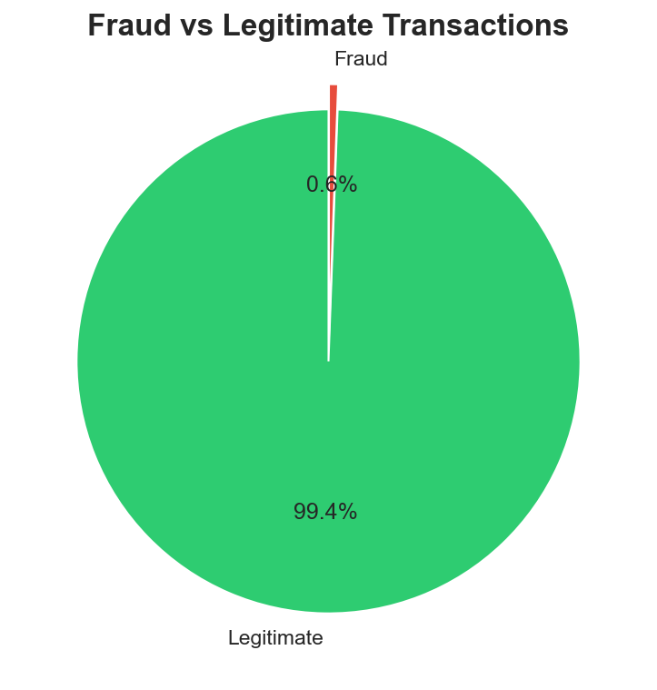

### Spending Analysis
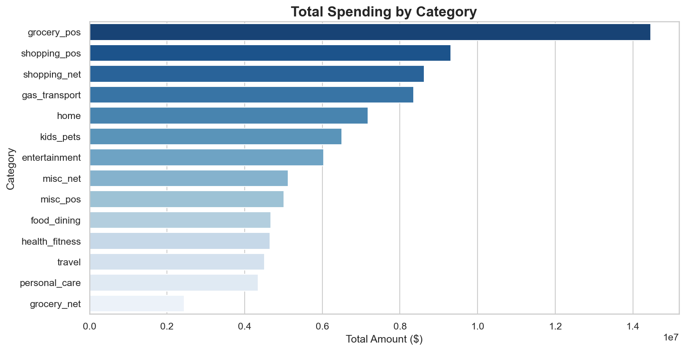

### Fraud Rate by Category
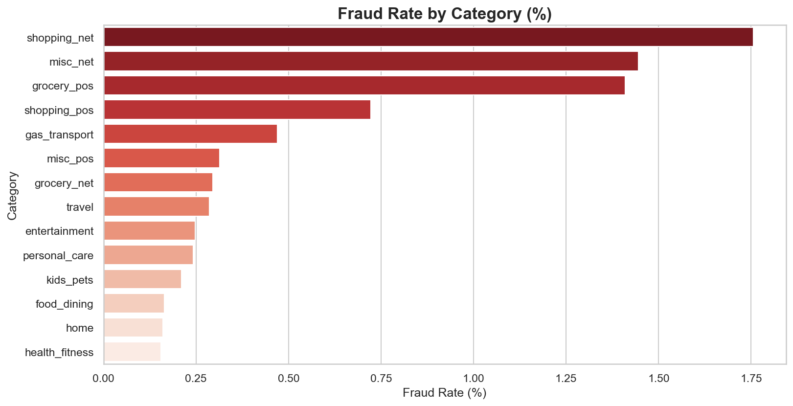

### Transaction Amount Distribution
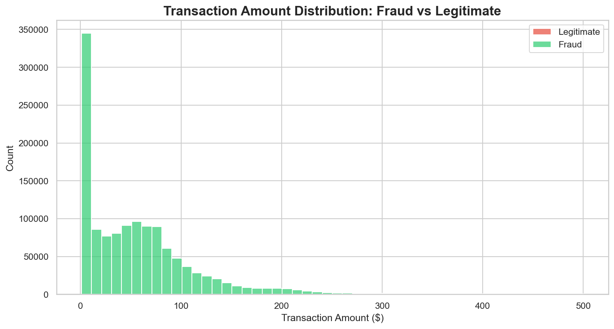

### Time Pattern — Fraud by Hour
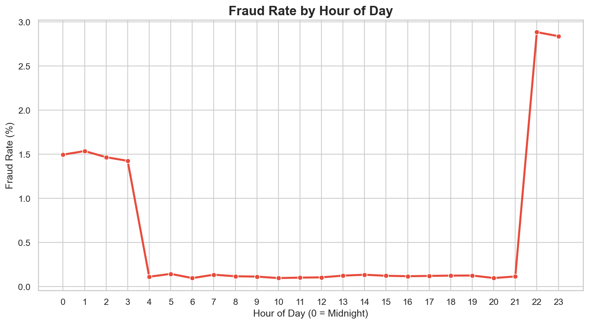

### Monthly Spending Trend
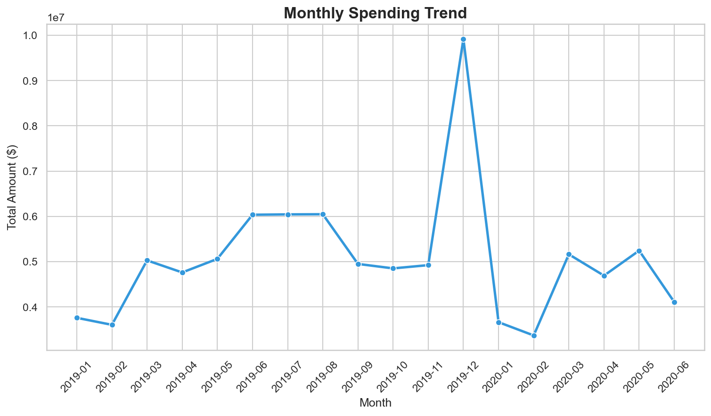

### Geographic Analysis
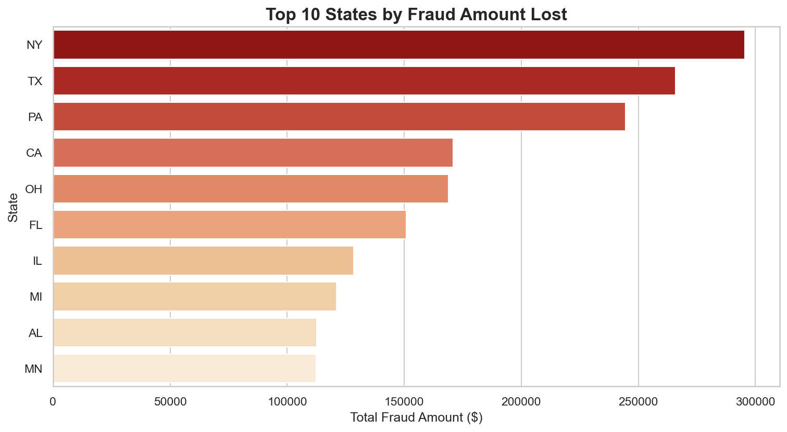

### Statistical Analysis — Correlation Heatmap
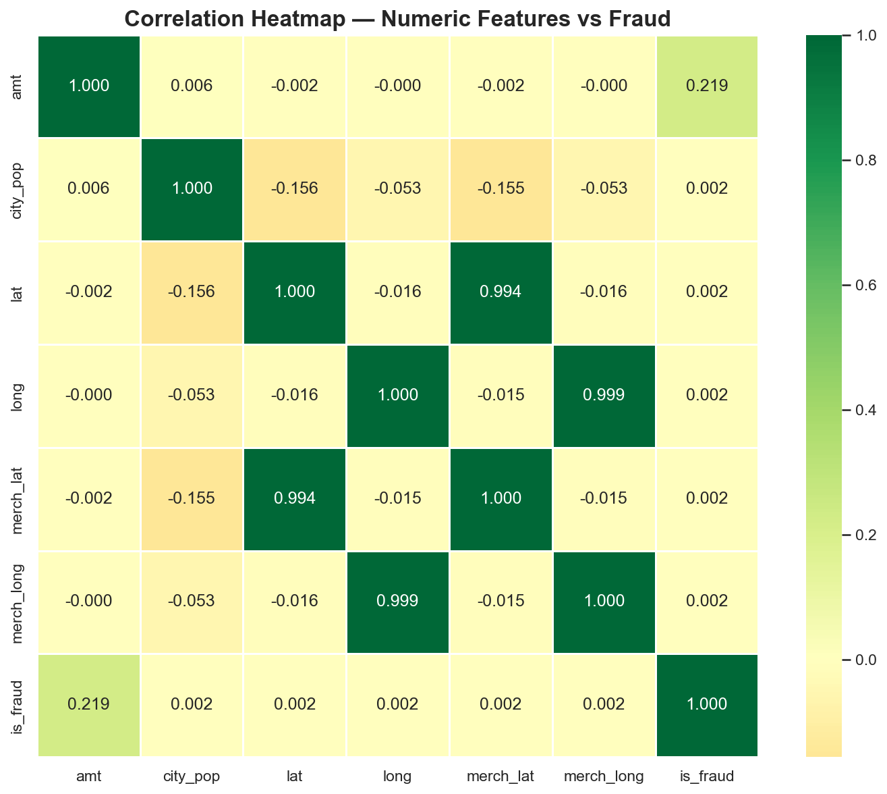

### ML — ROC Curve Comparison
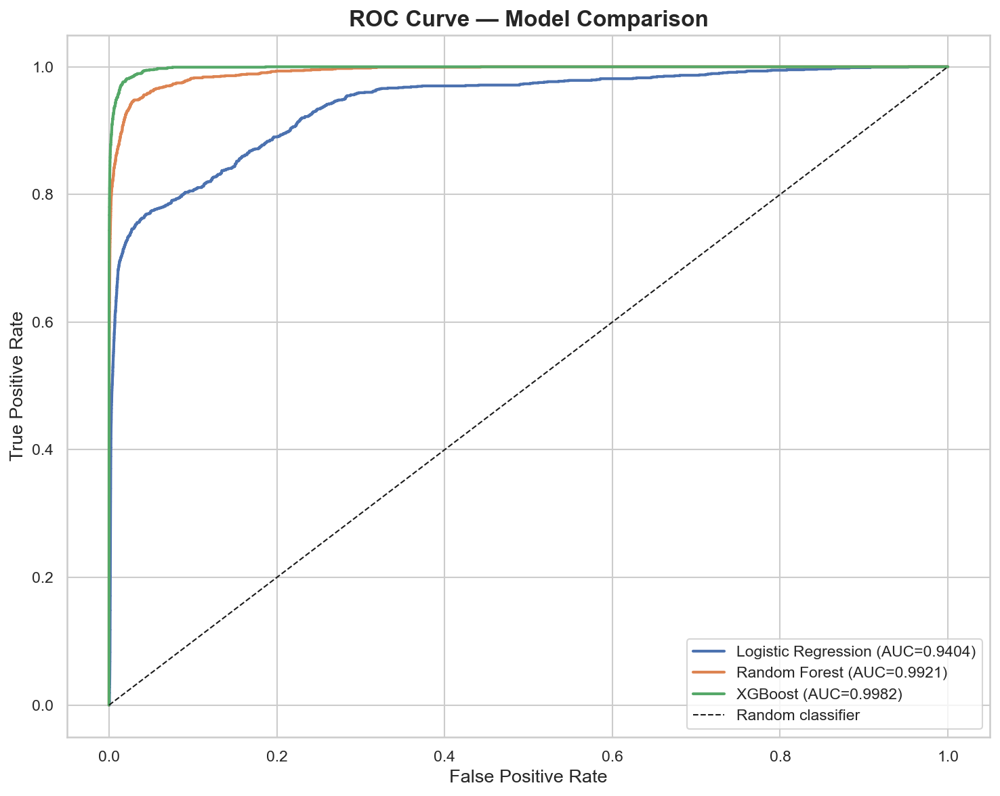

### ML — Feature Importance
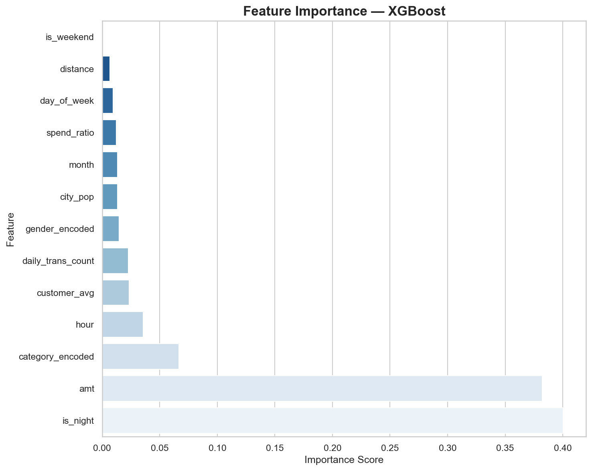

### ML — Confusion Matrix (XGBoost)
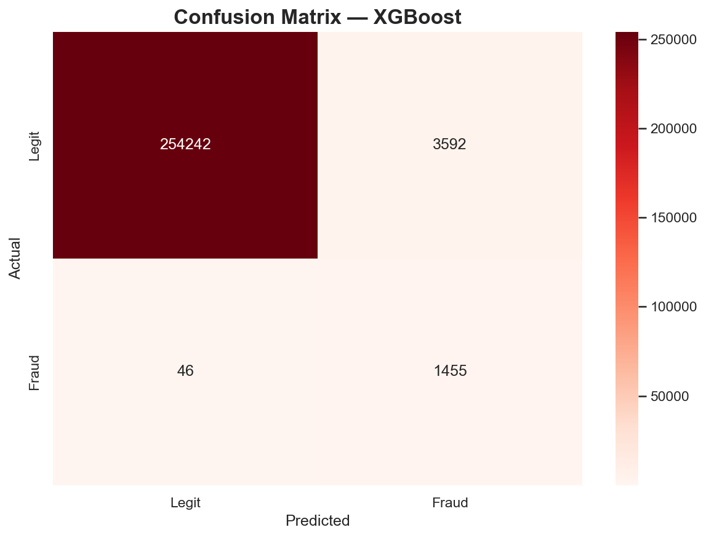

### ML — Model Comparison
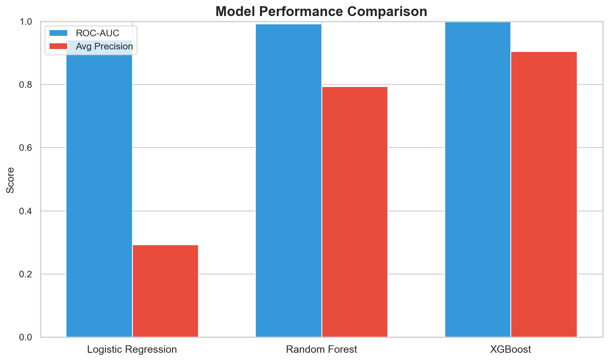


🖥️ Interactive Dashboard

Built with Streamlit — fully interactive with live filters:

**Features:**
- Filter by category, gender, amount range, transaction type
- 5 live KPI metrics that update instantly
- 8 interactive Plotly charts with hover and zoom
- Monthly spending vs fraud count dual-axis chart
- Raw data explorer with fraud-only toggle

**Run locally:**
```bash
streamlit run python/03_dashboard.py
```


📊 Statistical Analysis Results
```
Test 1 — Descriptive Statistics
  Fraud mean    : $531.32  |  Legit mean : $67.67
  Fraud median  : $396.50  |  Legit median : $47.28
  Fraud std dev : $390.56  |  Legit std dev : $154.01

Test 2 — Mann-Whitney U Test
  Result : Fraud amounts ARE significantly different (p < 0.0001) ✅

Test 3 — Chi-Square Test (Category)
  Chi2   : 6,486.00  |  df : 13
  Result : Category IS significantly dependent on fraud (p < 0.0001) ✅

Test 4 — Point-Biserial Correlation
  Correlation : 0.2194 (Weak Positive)
  Result : Amount IS significantly correlated with fraud (p < 0.0001) ✅

Test 5 — Chi-Square Test (Hour)
  Chi2   : 18,243.56
  Result : Hour of day IS significantly associated with fraud (p < 0.0001) ✅
```


🚀 How to Run

**1. Clone the repo:**
```bash
git clone https://github.com/YOUR_USERNAME/credit-card-fraud-detection.git
cd credit-card-fraud-detection
```

**2. Install dependencies:**
```bash
pip install pandas matplotlib seaborn psycopg2-binary plotly streamlit scipy scikit-learn imbalanced-learn xgboost
```

**3. Set up PostgreSQL:**
```bash
psql -U postgres -d credit_card_db
\copy transactions FROM 'SQL_Dataset/credit_card_transactions.csv' DELIMITER ',' CSV HEADER QUOTE '"';
```

**4. Run the pipeline:**
```bash
python python/01_visualizations.py
python python/02_statistical_analysis.py
python python/04_machine_learning.py
streamlit run python/03_dashboard.py
```


💡 Future Improvements

- Add deep learning model (LSTM for sequence-based fraud detection)
- Deploy dashboard to Streamlit Cloud (free hosting)
- Add real-time prediction API using FastAPI
- Implement model explainability with SHAP values
- Add geographic heatmap using folium


👤 Author

**Jeet Dave**
- GitHub: [jd878-gif](https://github.com/jd878-gif)
- LinkedIn: [jeetdave11](https://linkedin.com/in/jeetdave11)

---

📄 License

MIT License — feel free to use this project as a reference!

---

⭐ **If this project helped you, please give it a star!**
